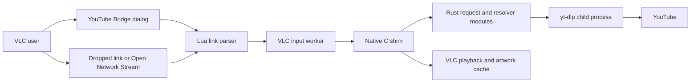
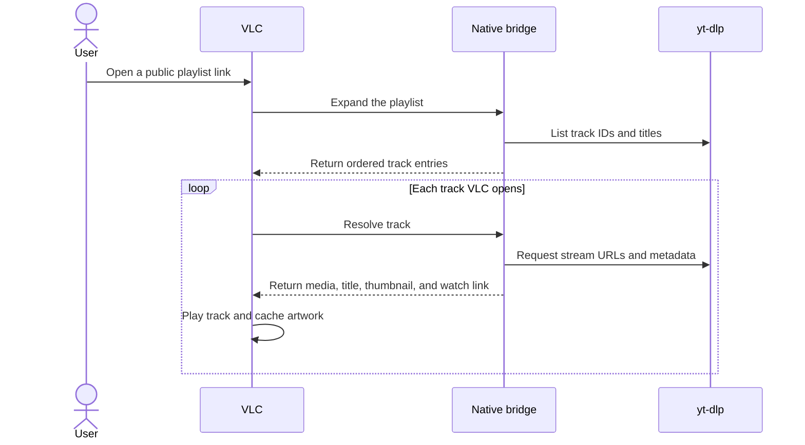

# YouTube Bridge for VLC

A Windows x64 VLC 3.0.24 plugin for YouTube and YouTube Music. A native VLC module uses Rust to run yt-dlp directly with a hidden child process. The Lua extension provides the controls under VLC's View menu.

## Install on Windows x64

1. Install desktop **VLC 3.0.24 x64**. [VLC Windows downloads](https://download.videolan.org/vlc/3.0.24/win64/)
2. Install the standalone Windows x64 **yt-dlp** executable and **Deno**. Both `yt-dlp.exe` and `deno.exe` must be on your user or system PATH. After installing them, open a fresh terminal and check `yt-dlp --version` and `deno --version`. [yt-dlp downloads](https://github.com/yt-dlp/yt-dlp/releases/latest) · [Deno installation](https://docs.deno.com/runtime/getting_started/installation/)
3. Download the **Windows x64 ZIP** under **Assets** and extract it. Use the ZIP whose name starts with `vlc-youtube-bridge-v`. [GitHub Releases](https://github.com/envp/vlc-yt-dlp-bridge/releases/latest)
4. Run `install-bridge.exe` from the extracted folder with `libyoutube_bridge_plugin.dll` beside it. The installer writes to your VLC profile and registers its plugin path for your Windows account. Administrator access is unnecessary.
5. Close all VLC windows and reopen VLC from the Start menu. Choose **View → YouTube Bridge**.

If the dialog reports that the native module is unavailable, verify that you're running VLC 3.0.24 x64 and install the [Microsoft Visual C++ x64 Redistributable](https://learn.microsoft.com/en-us/cpp/windows/latest-supported-vc-redist). If VLC reports HTTP 403, try reopening the original link or playing it on YouTube.

## Build from source

To build from source, install Rust with Cargo, LLVM `clang-cl.exe` on PATH, the MSVC C++ x64 build tools, and a Windows SDK. Cargo generates the C header with cbindgen and builds the DLL. It downloads and verifies the VLC 3.0.24 source headers unless you set `VLC_INCLUDE_DIR` to an existing copy.

```powershell
cargo build --release --locked
.\target\release\install-bridge.exe
```

## Play a video or track

In **View → YouTube Bridge**, paste a video, track, or playlist link. Click **Play video** for automatic video quality or **Listen** for audio only. The dialog closes when VLC accepts the request.

You can also drag a YouTube link from your browser into VLC's main window or paste it into **Media → Open Network Stream**. Direct links use video mode for YouTube and audio mode for YouTube Music. If a resolved link expires, open the original YouTube link again.

To copy the watch link for a playing track, open **Tools → Media Information**. On the **General** tab, right-click the YouTube link and choose **Copy Link Location**. For a finished track, open **Information** from its playlist entry.

The **General** tab also shows the track thumbnail once VLC downloads it. VLC's standard playlist view uses its usual row icons.

## Playlists

To queue a public playlist, use its playlist page link with `/playlist?list=…`. A watch link opens its individual video even when the link includes a playlist ID. VLC expands the playlist and resolves each track when it starts, so a transition can take a few seconds.

## Playback and privacy

Private videos, account features, and Premium playback stay in the official player. The bridge never reads browser cookies, credentials, or Google tokens. It also ignores yt-dlp user configuration and plugins so they cannot add account access to bridge requests.

VLC playback uses anonymous yt-dlp requests and can break when YouTube changes stream delivery. YouTube restricts automated access in its [Terms of Service](https://www.youtube.com/t/terms).

## Architecture



- The Lua dialog and playlist parser share link validation and translate supported links into internal `ytbridge://` requests.
- The native VLC module owns playlist expansion and playback item creation. It attaches the source URL, title, streams, and artwork metadata to VLC items and asks VLC to fetch the cover art.
- Rust dispatches requests and validates resolver output. It runs yt-dlp directly with a timeout and VLC cancellation support. cbindgen generates the C declarations from the Rust FFI exports.
- The Windows installer copies the Lua scripts and DLL into the user profile and updates `VLC_PLUGIN_PATH` for future VLC launches.

### Playlist playback



## Core tests

Run `cargo test --lib --locked --no-default-features` to test the Rust API without compiling the VLC shim. The core tests require neither VLC nor YouTube access. Windows also runs the subprocess timeout and cancellation tests.

## Releases

CI builds and tests Windows x64 on pushes to `main` and on version tags. To publish a release, update the Cargo version and push a matching tag such as `v0.2.0`. After the build and tests pass, GitHub Actions publishes the installer ZIP and its SHA-256 checksum.
